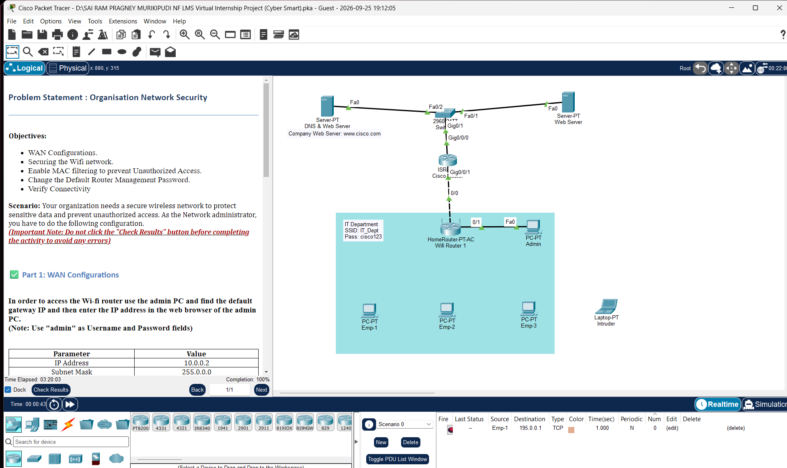

# NIIT–Cisco Cybersecurity Internship — Packet Tracer Project

<p align="center">
  
  
  
</p>

<p align="center">
  
</p>

<p align="center">

[View or Download Original Internship Certificate (PDF)](./internship%20certificate%20niit.pdf)

</p>

---

## Table of Contents

- [Overview](#overview)
- [Internship Context](#internship-context)
- [Organisation Network Security](#organisation-network-security)
- [Objectives](#objectives)
- [Network Topology](#network-topology)
- [WAN Configuration](#wan-configuration)
- [Wireless Security](#wireless-security)
- [MAC Address Filtering](#mac-address-filtering)
- [Router Administration](#router-administration)
- [Verification](#verification)
- [Security Note](#security-note)
- [Technologies & Concepts](#technologies--concepts)
- [Project File](#project-file)
- [Repository Contents](#repository-contents)
- [Internship Information](#internship-information)

---

## Overview

This repository documents the networking and cybersecurity activities completed as part of the **NIIT Foundation + Cisco Cybersecurity Internship**. The work was carried out using **Cisco Packet Tracer** and focuses on practical, hands-on networking and cybersecurity concepts, including WAN configuration, wireless network security, and access control.

## Internship Context

As part of the NIIT Foundation + Cisco Cybersecurity Internship, several practical activities were completed using Cisco Packet Tracer to simulate real-world networking and security scenarios. This repository contains the documentation, internship certificate, and project files for one of the core activities completed during the internship.

---

## Organisation Network Security

> [!NOTE]
> **Problem Statement:** Organisation Network Security
>
> **Scenario:** An organization needs a secure wireless network to protect sensitive data and prevent unauthorized access. As the network administrator, the task is to configure and secure the organization's wireless network.

## Objectives

- [x] Configure WAN connectivity for the organization's network.
- [x] Set up a secure wireless network using industry-standard encryption.
- [x] Restrict wireless access to authorized devices only.
- [x] Secure router administrative access.
- [x] Verify network connectivity and confirm that unauthorized access is blocked.

---

## Network Topology

The following image shows the network topology designed and configured using Cisco Packet Tracer.



---

## WAN Configuration

| Parameter | Value |
| :--- | :--- |
| **IP Address** | `10.0.0.2` |
| **Subnet Mask** | `255.0.0.0` |
| **Default Gateway** | `10.0.0.1` |
| **DNS Server** | `195.0.0.1` |

## Wireless Security

| Parameter | Value |
| :--- | :--- |
| **Wireless Band** | `2.4 GHz` |
| **SSID** | `IT_Dept` |
| **Security Mode** | WPA2-Personal |
| **Encryption** | AES |
| **Wireless Password** | Not disclosed (see [Security Note](#security-note)) |

## MAC Address Filtering

- Enabled MAC address filtering on the wireless router.
- Configured the router to permit only authorized employee devices.
- Verified that an unauthorized device was prevented from accessing the wireless network.

## Router Administration

- Changed the default router management password to a new, secure password.
- The router administrator password is not disclosed in this repository (see [Security Note](#security-note)).

---

## Verification

- [x] Connected authorized employee devices to the wireless network.
- [x] Verified network connectivity for authorized devices.
- [x] Confirmed that the unauthorized device could not access the wireless network.
- [x] Tested access to `www.cisco.com` from an employee workstation.
- [x] Completed the Packet Tracer activity with **100% completion**.

## Security Note

> [!IMPORTANT]
> This is a public repository. The actual wireless credentials and router administrator password used in the Packet Tracer activity are **intentionally excluded** from this README and are not published anywhere in this repository. They are referred to generically as "wireless credentials" and "router administrator password."

---

## Technologies & Concepts

| Category | Details |
| :--- | :--- |
| **Tool** | Cisco Packet Tracer |
| **Networking** | WAN configuration, IP addressing, subnetting, DNS, default gateway |
| **Wireless Security** | WPA2-Personal, AES encryption |
| **Access Control** | MAC address filtering |
| **Administration** | Router management password configuration |
| **Verification** | Connectivity testing, access control validation |

## Project File

| File | Description |
| :--- | :--- |
| `Organisation-Network-Security.pka` | Cisco Packet Tracer activity file containing the network topology and configurations. Open it with Cisco Packet Tracer to view and interact with the configured network. |

## Repository Contents

```text
├── README.md
├── Organisation-Network-Security.pka
├── packet-tracer-topology.png
├── internship certificate.png
└── internship certificate niit.pdf
